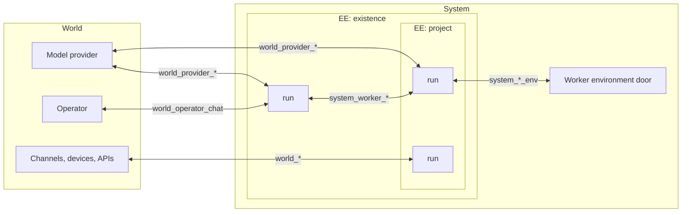
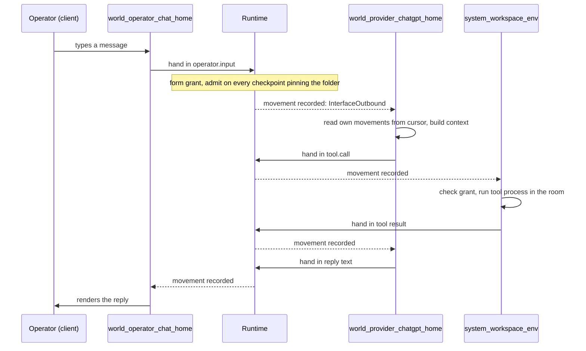

# Architecture

Octopus is a self-evolving agentic operating system. It is built on
operating-system principles, with an architecture that lets agents reshape
their execution environment and influence the trajectory of their future work.

The usual agent is a loop around a model: act, observe, accumulate context,
repeat. Memory, skills, sub-agents, and schedules are then bolted onto that
loop, and everything the agent can do has to fit inside it. Octopus is built the other
way around. Neither the model nor the loop is at the center. There is a
small kernel and a set of primitives, and the loop is one of the things those
primitives express.


*Conceptual comparison: System and World distinguish control, not deployment
locations.*

The runtime is the kernel. Models, clients, tools, rooms, memory, and sensors
are applications and drivers attached to it through JSON descriptors and one
boundary contract. The kernel is about 45,000 lines of Rust. Most of the code
in this repository is what has been ported onto it - starting with Codex CLI,
which runs here as one interface among many.

The design is intentionally small in primitives and intentionally large in
descriptors. A few primitives, thousands of JSON files. The reason: every time a capability is added by declaring something instead of
coding a branch, the system gains one more thing it can inspect, replay, and
change about itself. That is what lets it grow in any direction - connect
something new, give itself a new sense, rewrite itself - through contracts
built into the architecture rather than add-ons on top of it.

This document is the overview. The [contracts](contracts/README.md) carry
the detail, and the [glossary](glossary.md) defines every term.

## Install the system, then choose the software

The operating-system analogy describes how you build a working environment.
You install the base once, keep your Home, and add the applications and drivers
you need. A new task should not require a different agent product or a rewrite
of the kernel. It needs suitable software, bindings, and permission to use them.

For example, suppose the system needs to read a new measuring device. If an
existing interface driver speaks its protocol, the addition is a descriptor
and configuration. If it does not, someone writes a package that reads the
device and returns artifacts. That someone can be a coding worker acting
through granted tools. Once installed and bound, the package is available for
later work without building it again.

That is the architectural meaning of "what it cannot do, it can write": the
system can acquire software through its own ordinary work. Model capability,
the device or API, permissions, and verification determine whether a particular
attempt succeeds. [Extending Octopus](contracts/EXTENSION_SURFACES.md) describes
the package boundaries; the [client guide](client.md#where-packages-come-from)
explains today's local distribution path.

## System and World

There are two sides, and they are defined by control, not by location.

**System** is the set of all environments and capabilities the system can act
on. This is where Octopus organizes goals, runs, and tool execution. Runs can
exchange artifacts through System interfaces: one worker's result can become
another worker's input, within their bindings and policy.

**World** is everything outside that controllable framework. Octopus can send
artifacts to it and receive artifacts from it through declared interfaces. It
cannot place its own runs inside an external service or coordinate that
service's internal execution as though it were part of System.

| Direction | What it means | Example |
| --- | --- | --- |
| **World → System** | An interface admits external input as an artifact. | A camera observation or a message from a person. |
| **System → System** | Work is coordinated through internal interfaces. | A research worker passes findings to a coding worker. |
| **System → World** | An artifact crosses an interface to request an action or deliver output. | A message sent through a service, or audio delivered to a speaker. |

There is no second Octopus execution graph inside World. To use a calendar
event to send a message, the system receives the event, processes it in a run,
and emits an artifact through the messaging interface. The coordination is
**World → System → World**; the calendar and messaging service do not become
Octopus workers.

An interface can expose an API, a device, a human channel, a model, or an
internal worker. Its implementation determines what it can receive and do;
the architectural contract remains artifact in, artifact out. A local camera
adapter can therefore be World-facing, while a remote execution environment
can belong to System. Physical location does not define the boundary.



The architecture is not input → processing → output. Data appears at typed
interfaces, is admitted under policy, and may create goals, runs, new
environments, memory updates, new tools, or outbound transfers.

## The primitives

### Interface

The most important primitive. An interface is a typed port: **artifact in,
artifact out**. Whether a language model sits behind it or a simple transform
that turns text into audio is the interface's private business. The runtime
never looks inside, and only artifacts ever cross the boundary.

Every external API, every sensor, every chat channel, every model provider is
an interface. So is every internal control surface: the door of a tool room is
an interface, and a worker is an interface. Adding an integration means
declaring an interface, not changing the kernel.

An interface's identity is its folder in `registry/interface/`. There is no
other identifier. Two private conversations are two interface
folders. That is how nothing leaks between threads without anyone having to
narrow anything.

An interface also decides what counts as input at all. Raw sound is not an
artifact; what passes a wake-word threshold becomes one. The interface decides where raw input becomes an artifact.

→ [Interfaces](contracts/INTERFACES.md)

### Artifact

Any data that crosses a boundary: a message, a diff, a screenshot, an audio
file, a memory pack, a tool call, a tool result. What crosses is a manifest - a
self-identifying name and a reference to where the payload lives, pinned by
content hash. The payload can be a file or a whole directory; the reference is
the artifact.

There is no runtime `kind`. How an artifact names itself is the vocabulary of
the interface that emitted it, and the kernel never reads it. Per movement the
kernel sees three things: the route, the caller, and the movement itself.

Think of data travelling through a network: useful content travels with the
information needed to deliver and account for it. In Octopus, the manifest
identifies the payload; the movement and invocation metadata say which exact
interfaces, run, checkpoint, and formed grant this delivery belongs to. The
receiving interface interprets the content. These are distinct records, not a
single network packet or an arbitrary `metadata` field in the manifest.

→ [A concrete artifact and its metadata](contracts/ARTIFACTS.md#payload-manifest-and-delivery-metadata)

→ [Artifacts](contracts/ARTIFACTS.md)

### Run and checkpoint

A run is the execution record: which worker it wears, which environment it
lives in, and its checkpoints. A **checkpoint is an artifact crossing an
interface** - the arrival or the departure. A run awaiting a model reply, a run
awaiting another run's result, and a run reaching another run are three faces
of the same thing: a binding on a checkpoint.

A run is data, not a process. It holds no thread and no lease while it waits.
It does not really start or end; it idles, parks on a checkpoint, and wakes
when the awaited artifact lands.

### Worker

A worker is what the rest of the field calls an agent, with one difference in
where it lives. Elsewhere an agent is a process: a loop, a prompt, and a tool
list held together by code. Here the loop belongs to the architecture, so what
is left of an "agent" is a description: who it is and the most it may ever
touch. That description is the worker.

You can run many of them without wiring their roles into the kernel. A run
names a worker pin; the pin's `role_artifacts` name the role and grounding
content that must be explicitly bound into the run's context.

A worker is not an engine and has no code. It is a **System interface**: a
folder `registry/interface/system_worker_<name>/` with two JSON files - the
interface descriptor and a `policy.json` ceiling that says what a run wearing
this worker could do at most. A new worker is a copied folder with a new id and
edited lists, with no Rust changes.

A coder and a web worker are each one such folder, and all pins are equal.
Which worker a run wears is authored in the
run record; which workers it can reach is the set of `system_worker_*` ids in
its ceiling.

→ [Workers](contracts/WORKER_TYPES.md)

### Execution environment

An EE is a scope classified by a goal and bounded by a policy. Runs live inside
EEs. EEs nest, and an inner EE can only be narrower than the one around it. The
initial root goal is `existence`; under it sit goals like an operator space, a project,
memory maintenance, self-improvement. None of these names is a constant in
code - each is a template in `registry/ee_template/`.

Long-running and one-shot environments are the same primitive. An EE exists
while its JSON record exists. Parentless instances form independent roots. The
single `bootstrap_root` template selects the initial seed, not the only permitted
root. Each root forms policy from its own template, instance narrowing, worker
ceiling and bindings, without inheriting another root's policy.

### Worker environment

A worker environment is needed **only when tools must act on the world**: a
workspace, a git worktree, a browser session, a desktop, a container, a remote
machine. It is the room where tool effects physically happen and the thing that
provides the tools. A run that only transforms an artifact needs none.

A room is exactly three parts: a kind (the executor that defines the possible
tools), a door interface, and the policy formed for it. A tool call is an
artifact sent to the door; the door checks the grant, runs the tool inside the
room, and returns a result artifact.

Do not confuse the two environments. An EE answers *why* and *what is allowed*.
A worker environment answers *where the effect happens*.

→ [Environments](contracts/ENVIRONMENTS.md), [Tools](contracts/TOOL_REGISTRY.md)

### Policy

Policy is what every run needs to answer two questions and only those: **what
can I do, and what do I need to do.** Its inputs are stored in descriptor and
run JSON. The effective grant is formed at every arrival by a deterministic
script, rather than trusted as a saved list or a prompt instruction:

```text
grant = worker-interface ceiling  ∩  the EE chain the run lives in  ∩  the run's authored bindings
```

The bound interface projects that grant into the model's context and tool list.
Enforcement still happens outside the model.

→ [Policy](contracts/POLICY.md)

### Mark

A mark is a success tick in the ledger: this checkpoint's requirement was
closed by this artifact through this verifier. Neither the model nor an interface can emit a mark. The runtime records one after a verifier passes the
artifact.

→ [Marks and verifiers](contracts/VERIFIERS.md)

## The agent loop

The agent loop still exists in Octopus. It is not a mechanism in the
runtime; it follows from artifacts.

A run sends a request artifact to a provider interface. The model's reply
arrives as artifacts - the text as one, each tool call as its own. Each lands
on the checkpoint whose binding it was emitted into. A tool call goes to a
room's door and its result comes back as an artifact; an outbound reply goes to
the operator's interface. The turn continues because the model keeps emitting
tool calls and ends when it emits a reply. There is no loop mode, no
runner every worker passes through, and no supervisor deciding who goes next.

The same is true of everything usually built as a subsystem:

- **Spawning a worker** is emitting an artifact to its interface, or writing a
  new run record with a granted file tool.
- **Escalating** is emitting an artifact back through a binding your creator
  left for you.
- **Using memory** is holding a binding to an artifact.
- **Scheduling** is an interface that emits an artifact at a configured time.
- **Waiting** is a checkpoint that has not been met yet.

Every one of these is a run emitting an artifact to an interface under ordinary
policy. That is why nothing in the code routes one worker to another. A run can be
persistent, awaiting an artifact; another run has policy to emit to it. Any
worker may reach another, or author a run for it, if its policy grants it. No worker is
privileged in code; authority comes from policy.

## One turn, end to end

You type a message in Home and Octopus reads a file to answer it. This is what
moves. The interface ids are the kind a fresh install authors; the artifact
names are each interface's own vocabulary.



1. **Arrival.** The client materializes your message as an artifact and hands
   it to the runtime at the Home chat interface. The hand-in *is* the interface
   binding; there is no separate request lane. From Home, the same artifact
   also carries the client's snapshot of tasks, triggers, projects and Agents,
   so what the model knew is part of the recorded input.
2. **Admission.** The runtime finds every active checkpoint, in any run, that
   pins that interface folder and can take the artifact's name. For each one it
   re-reads the run record from disk, forms the run's grant, checks the
   binding, and records the movement. The Home input is a standing route: the
   next message enters the same checkpoint, and nothing rewrites the run first.
   Each edge gets its own verdict; a refusal on one never becomes a success or
   a redirect somewhere else.
3. **Outbound.** The Home run's checkpoint names the provider interface as its
   outbound binding. The runtime records that movement. Nothing is pushed: the
   provider interface is a live process reading its own movements from its own
   cursor.
4. **Context.** The provider interface assembles what the model sees - the
   bound role and grounding artifacts, the conversation it owns, and the grant
   projection the runtime attached to the invocation. There is no context
   builder in the runtime. The interface renders the prompt *and* the tool
   list, and it may hide tools from the model that it keeps for itself.
5. **Tool call.** The model asks to read a file. The interface hands that in as
   its own artifact. It reaches the door of a workspace room. The door parses
   its own payload, checks the requested tool against the grant it was handed,
   and runs the tool's declared process inside the room, under the authority
   the descriptor declares.
6. **Result.** The result returns as an artifact through the same contract and
   the provider continues. The write that carried the call armed a one-shot
   wait for this result, with the call already in the wait's context, and kept
   every result door armed, so the result enters directly, needs no write of
   its own, and the next step can still call any tool the grant reaches.
7. **Reply.** The model emits text. That artifact lands on the checkpoint bound
   to the chat interface; the client renders it. The turn is over.
8. **Turn boundary.** Within the turn, the provider's outputs ride the standing
   routes its last write left; it records which of them it delivered in its
   own private journal. It writes the run once at the end of the turn and once
   for each tool call that waits for a result, the same way anything else in
   the system changes: a file-write tool call against the run record, in a room
   whose path covers it. A write installs the context gathered so far and the
   next routes; a call joins the run's context in the write that consumes its
   result. If the room cannot report whether a write landed, the target's own
   content decides; a write that did not land is void and is authored again.
   **The path is the permission.**

Every arrow that says "movement recorded" is one row in
`ledger/movements.jsonl`. If the tool room had refused the call, that would be
a row too - a typed `DeliveryRefused`, not a silent drop. If the provider can
no longer read its own state in the Home run, it neither loops nor goes quiet:
the failure reaches the chat as `turn.error` through the run's standing route,
and only a run with no provable route gets no arrival at all.

## How policy is formed

Everything that is not execution code is policy: who may reach whom, which runs
persist, which run holds the widest authority in a given environment. None of it is hardcoded and none
of it is a function name.

The grant has three inputs and one notable absence. The ceiling comes from the
worker pin the run wears. The narrowing comes from every EE layer between the
run and the root. The bindings are whatever was authored on the run's
checkpoints. **Who created the run is not an input.** A run with few tools can open a coding environment and a capable coder runs
inside it; the coder's grant comes from where it lives, not from the run that
created it.

A run reads its grant from the envelope that arrives with its artifact, the way
an OS hands a process its environment at exec. Formation walks that run's own
EE ancestor chain; it does not traverse the history of who created whom or
precompute every descendant's capabilities. This is how the design aims to
support a thousand nested and parallel environments, each handing its workers
a minimal, non-conflicting grant.

The alternative - telling every run "you can do everything, but here is what is
happening around you, do not conflict" - leaves runs with conflicting, unbounded context. The minimal composed grant
is what keeps nested goals workable.

The effective grant is recomputed rather than received as an artifact that
claims authority. Its projection accompanies an invocation and is retained
with the movement evidence. Replay works because formation is pure: same
descriptors and run records in, same grant out. Each formed grant pins the
hashes of the descriptors it was formed from and retains their normalized
bytes in the content-addressed blob store. A hash alone would not recover a
descriptor after someone edited it.

## Marks and verification

A checkpoint can declare `required_verified_artifacts`: this label, this
verifier, these parameters, this mark. When an artifact with that label
arrives, the verifier runs on the edge. Pass, and the runtime records the mark.
Fail, and the ledger gets a `VerificationFailed` movement, the checkpoint stays
open, and the interface that sent the artifact decides whether to try again.

A verifier is a removable script package in `registry/verifier/` - a
descriptor and a script that reads a request on stdin and prints a verdict.
Any language. Delete the folder and only the checkpoints that reference it
break.

Marks record which checkpoint requirements passed, with the evidence and
verifier behind each result. A checkpoint with required verified artifacts
stays open until those requirements pass. The mark proves only what its
verifier checked.

## Coordination between runs

Runs coordinate through artifacts arriving on checkpoint bindings. Two runs
work at the same time, each parked on a checkpoint awaiting something the other
has not produced yet; the producer's artifact arriving on the waiter's binding
is the wake. When that arrival must be proven, the checkpoint requires a
verified artifact, and the admitted mark is what wakes it.

Artifacts travel in any direction - worker to worker, interface to worker,
bottom-up, sideways - because runs coordinate only through artifacts and
declared waits, never through a fixed parent-to-child order. There is no execution queue
to schedule, because interfaces execute themselves.

Nothing blocks. A waiting run holds nothing. Two runs each waiting on the
other are two unmet checkpoints, visible as data. The fix is an ordinary
granted JSON edit. There is no deadlock detector and no watchdog, because there
is nothing to hang.

## Restart and recovery

Goals, completed work, and pending waits are data on disk, not process state.
An Octopus Home is a directory:

```text
~/.octopus/
  registry/                  the active descriptors
  state/runs/<run>.json      run records and their checkpoints
  state/ee_instances/        EE records and their place in the tree
  ledger/movements.jsonl     the append-only movement log, the source of truth
  ledger/blobs/              artifact manifests pinned by content hash
  ledger/ledger-index.sqlite a disposable index over the log
  interfaces/<id>/           each interface's private state and cursor
  host.json                  this machine's root slots
```

Stop the runtime and start it again, and the goals are still there. The
runtime scans the
JSON, wakes every interface mentioned on a live binding, and each interface
catches up on its own movements from its own cursor. The cursor is written to
disk when the interface settles one of its own movements; reading past other
interfaces' movements stays in memory, so a busy ledger does not make every
live interface flush the disk on every append. An interface whose life dies,
even before it is ready, is lifted again with backoff; the runtime log says
when it falls into coma and when it wakes. Interfaces wake in no promised
order: one that hands work to a sibling still waking up waits for it, within
the hand-in's declared timeout. A stopped interface loses nothing; an unread result is an ordinary consequence of the architecture, not a
loss to be repaired with leases and retries.

A restart does not end the work in flight either. A command a room started
keeps running in its own keeper process, outside the tool process and the
runtime; the call that was waiting on it is re-delivered after the restart and
receives the command's own output and exit code, exactly once per call. Start
identity and per-call responses stay in the room's durable formation state
after the keeper expires or the process is released. If an outcome cannot be
established, recovery reports it as unknown. Cleanup never makes the same
invocation a new command. The provider continues the turn the restart cut off by itself: it starts
the next native turn on the same thread with the late result in context, the
way the Resume control does, without any client attached. A turn the operator
stopped stays stopped. The runtime also outlives the terminal that launched it,
so relaunching the client never stops it.

Stopping and restarting the runtime is a path, not a signal. A running runtime
listens on `state/runtime-instance/control.sock` in its Home; `octopus down`
asks it to stop and `octopus restart` asks it to stop cleanly and start again
as itself. Whoever can reach that path may stop or restart the runtime: the
operator's terminal, or a run whose room grants it. A room cannot signal the
runtime's processes, and a command started from a room cannot launch a second
runtime, because it would inherit the room's sandbox.

Control status includes the lifecycle manager's current `interface_failures`,
including a life that stops after declaring readiness. This observation is held
in memory and remains available when the ledger cannot be written. A ready root
does not imply every interface life is available. Failure of one life leaves
healthy siblings running; successful readiness clears its failure. The client
shows the exact bound provider as unavailable without inventing a terminal
ledger movement.

There is no recovery subsystem. This follows from intent, obligation, and
memory living in files rather than in a running loop.

Indexes are caches, not a second source of truth. The kernel keeps an in-memory index
for its own idempotency checks; a SQLite file beside the log serves readers in
any language. Delete either and it rebuilds from the log.

→ [Ledger and indexes](contracts/LEDGER_INDEX.md)

## The registry

Every dynamic thing is a descriptor in a registry folder:

| Folder | What lives there |
| --- | --- |
| `registry/interface/` | Every interface - providers, channels, doors, and workers - with its own driver code when it has any. |
| `registry/ee_template/` | Goals and their policy. |
| `registry/worker_environment_kind/` | Room kinds and their executors and tool binaries. |
| `registry/tool/` | Tool descriptors pointing at a room's executables. |
| `registry/verifier/` | Check packages. |
| `registry/mark/` | The vocabulary of outcomes. |
| `registry/artifact/` | Declared context artifacts: roles, grounding, skills. |

Descriptors are read from disk and picked up live. A malformed one is rejected,
never defaulted. The runtime does not know package names: adding a Telegram-like
channel, a provider, or a worker must not require touching app bootstrap or a
manager named after the concept. If it does, a primitive has leaked.

This is what makes self-modification an ordinary operation instead of a
feature. Two things get that name, and they are different:

- **Descriptor-level.** A run with the grant writes a new interface folder, a
  new worker pin, a new EE template. Plain file edits. The system now listens
  to something it did not listen to before, or has a worker it did not have.
- **Source-level.** A run edits the framework's packages and, where necessary,
  its kernel through a granted workspace, following the development rules and
  preserving the kernel's generic contracts. A git-worktree room supplies branch
  isolation when requested. Verification belongs to the affected owner;
  checkpoints may require marks where proof is useful.

Drivers and packages may be written in any language. Only an artifact crosses
into the runtime, so the kernel does not know the difference. The registry
ships interfaces written in Rust and in Python.

→ [Registry descriptors](contracts/REGISTRY_DESCRIPTORS.md),
[Extending Octopus](contracts/EXTENSION_SURFACES.md)

## Memory, skills, persona

Memory is an artifact. A skill is an artifact. A
persona is an artifact bound to a run, and it can differ per run.

A run sees only what it holds a binding for. "Give me relevant memory" is an
artifact binding, not a query against a global store. Updating a skill after
the world changed is an ordinary run editing an artifact under policy. The runtime itself never
learns the word "skill": that keeps skills something the registries can evolve.

→ [Memory and skills](contracts/MEMORY_AND_SKILLS.md)

## The desktop client

**The desktop client is optional: the runtime can run without it, and another
client can present the same architecture.**

The desktop app reads
projections of the registries and the ledger, and it acts by handing artifacts
to declared interfaces. Its vocabulary is presentation:

| In the app | In the architecture |
| --- | --- |
| Home | One continuous run in the root environment, bound to your chat and voice interfaces. |
| Project | An EE. |
| Agent | A named, reusable worker template - a `system_worker_*` pin plus authoring defaults. |
| Task | A run. Later messages continue the same run through new checkpoints. |
| Application | An installable interface or context package: provider, connector, plugin, or knowledge. |
| Driver | A worker-environment kind: workspace, browser, desktop, container. |
| Extension | A client widget, tab, panel, or guided repair. No runtime authority of its own. |

Windows, panes, onboarding, file preparation, and package installation are the
client's own business. They are things the operator does, not things a model
does, and they are not routed through runtime policy for the sake of formal
consistency. The architecture governs autonomous effects.

The [desktop client guide](client.md) covers navigation, voice, experimental
interaction, and the local package installation path.

For example, **Dashboard → Topology** renders EEs, runs, and exact interfaces
as a navigable graph. Selecting an environment exposes its runs and bindings.
The graph reads the system's records; a visible node alone does not prove that
an interface is live or a tool succeeded.


## Autonomy and attention

The research question is: **how can an architecture that lets agents reshape
their execution environment help them take initiative and steer their own long-term development?**

**Self-evolution** is this process of changing the environment that shapes
subsequent activity. Under policy, agents can create and revise goals, change
interfaces and external triggers, add tools, organize workers, and arrange
context and execution environments. This is native to the existing primitives:
goals classify EEs, interfaces admit events, workers and tools are descriptors,
and context reaches runs through artifact bindings. Authorized runs change
these structures through ordinary work.

The focus is the trajectory across goals, tasks, and runs. A new listener changes
what the system notices; a revised trigger changes when it acts; new goals,
tools, and context change what it can do next. These changes persist beyond the
task that made them. The resulting experience can inform the next revision of
the environment, so the system can keep redirecting its own activity over time.

**Self-improvement** remains the broader research aim and a possible result of
self-evolution: the changes must actually make the system better. Persistent
goals and artifact exchange make useful initiative possible; whether models
use them effectively and improve over time is an empirical question. A run can
wait for input; the architecture does not require continuous activity.

Attention is part of that question: what should wake a run? A model can use
its observations to configure an interface that listens for a relevant event,
then bind a run to that interface. Existing driver behavior can be configured
through JSON; a new kind of listener may also require package code.

The framework provides the boundaries and records the results. Whether a model
uses these capabilities effectively is an empirical question.
[Scenarios](scenarios.md) illustrates the camera, wake-word and
return-after-a-pause examples.

## What is not solved

- **Models do not take initiative yet.** In our runs so far, current models  - 
  GPT-6 included - do not use these affordances on their own, and for an
  ordinary coding task the architecture gives nothing over Codex CLI itself.
  Studying how models use changes to their execution environment to direct
  future activity and improve over time is why this is research.
- **The preview is one provider deep.** The path exercised end to end is
  ChatGPT/Codex on macOS. Other descriptors exist; a descriptor is not a test.
- **A mark is only as strong as its verifier.** "It builds" is a check. Proof
  that a coder stayed on-contract and wrote nothing harmful is not designed
  yet.
- **A capable model routing around its own policy** is acknowledged, not
  solved. Policy and marks are the control surface; they are not a proof of
  safety.
- **Emergence is a hypothesis.** The framework provides the affordances and
  records what runs do with them.

## Read next

- [Contracts](contracts/README.md) - the detail behind every section above.
- [Extending Octopus](contracts/EXTENSION_SURFACES.md) - the cookbook.
- [Security model](security-model.md) - what stands between a model and an
  effect.
- [Development](development.md) - where each piece lives in the source.
